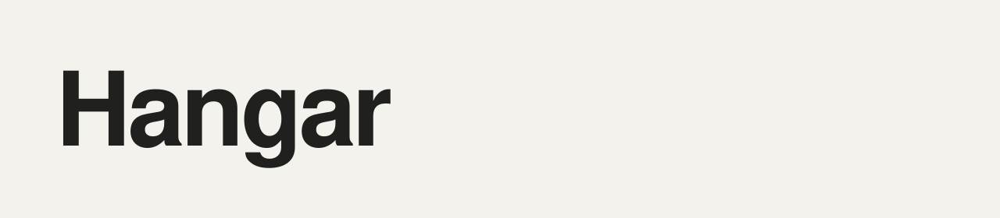
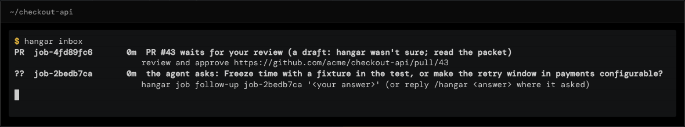

# Hangar

**Your team wants to hand tickets to coding agents, but not to a laptop with everyone's credentials and no record of what ran.** Hangar runs Claude Code, Codex, pi and Antigravity in isolated cloud sandboxes, checks their work with your repo's own tests and hands back a draft pull request.

Documentation site: **[sean-koval.github.io/hangar](https://sean-koval.github.io/hangar/)** · part of the [agent factory](https://sean-koval.github.io/agent-factory/)


<sub>Recorded by [`docs/assets/front/make.py`](docs/assets/front/make.py) against the demo hangar (the fake provider, a scripted agent and a stand-in GitHub); [MP4](docs/assets/front/hangar-demo.mp4).</sub>

## What it looks like

The web UI on `:8787`: jobs with their timeline, the agent's activity, the check and the PR; sessions you come back to; and the inbox of everything waiting on you.




## Where it sits

Many doors bring work in; hangar runs it; the pull request is the one gate out. Sister tools define the harness (ai-dlc), judge the runs (flightdeck) and govern risky actions (the governed workspace).

<picture>
  <source media="(prefers-color-scheme: light)" srcset="docs/assets/front/hangar-suite-light.png">
  
</picture>

## Use cases

- **Ticket to draft PR.** A product engineer labels a Jira or GitHub issue `hangar` (or moves it to "Ready for agent"). Hangar starts a sandbox from the repo's environment, the agent fixes it, hangar runs the repo's check and opens a draft PR that closes the issue. The engineer reviews a PR, not a chat log.
- **Delegate from your own agent.** A developer in Claude Code or Codex says "hand this to the cloud" with the [hangar skill](skills/hangar/SKILL.md). Their uncommitted changes go along; three attempts run in parallel (`best_of_n`); they pick the best and pull its patch back, while their laptop stays free.
- **One fleet for the team.** A platform engineer runs one hangar on GKE. Everyone connects their own client with their own token; credentials stay behind a gateway, budgets and fairness cap spend, and the inbox brings each person their reviews, approvals and agents' questions.

## Quickstart

You need [Docker](https://docs.docker.com/get-started/get-docker/) and [uv](https://docs.astral.sh/uv/getting-started/installation/) (Python 3.12+ is managed by uv).

```bash
git clone https://github.com/Sean-Koval/hangar.git && cd hangar
uv sync --all-extras
uv run hangar up        # server, CLI login, the claude-python environment, MCP clients
uv run hangar cred add claude-api --harness claude-code --kind api_key --file anthropic-key.txt
uv run hangar doctor    # every check passes, or names its fix
```

Open the dashboard at [localhost:8787](http://localhost:8787) and ask your MCP client: *"Use hangar to fix the failing test in https://github.com/YOU/REPO and open a draft PR."* Use an API key with a spend limit; subscription logins are for your own interactive sessions only ([why](docs/team.md#subscription-logins)).

To look around first without Docker or a key, run the demo hangar the recording uses: `uv run python docs/assets/front/demo.py`, then `uv run python docs/assets/front/demo.py ticket` in another terminal.

The [docs home page](https://sean-koval.github.io/hangar/#first-task) walks through a first task, parallel attempts, your own environment and everyday commands.

## Features

| Feature | What it gives your team |
| --- | --- |
| **Many front doors** | MCP clients, the CLI, REST, GitHub issues and Projects, Jira, Slack, webhooks, schedules and A2A all become [jobs](docs/jobs.md) or [sessions](docs/sessions.md), with one [repo policy](docs/repo-policy.md) for each repo. |
| **Isolated sandboxes** | Each has its own files, tools, checkout and agent configuration, from [environments](docs/environments.md) you prepare once; fork a prepared one into parallel attempts. Docker, gVisor or Kata, GKE or E2B. |
| **Any agent** | Claude Code, Codex, pi and Antigravity as [harnesses](docs/harnesses.md), pinned by version; a Codex client can ask for Claude Code and the other way round. |
| **Verified delivery** | The repo's own check runs before anything is pushed; hangar pushes through the git gateway and opens a draft PR with a review packet; with [landing](docs/landing.md), an approval lands it. |
| **People in the loop** | [Steer](docs/steering.md) a running agent, answer its questions where it asked (the ticket, the Slack thread, MCP), watch its terminal; the inbox lists what needs you. |
| **Resumable sessions** | The conversation and repo state survive the sandbox; come back days later or fork a session. |
| **Hostile-sandbox security** | Credentials stay behind a gateway; intake jobs get an egress allowlist and no push rights; tainted work opens as a draft and needs a second person. See the [security model](docs/security.md). |
| **Usage and insight** | Tokens, cost and budgets per job and person ([activity](docs/activity.md)), traces as OTLP ([observability](docs/observability.md)), and run capture for [flightdeck](docs/specs/0014-sister-tool-interfaces.md). |

## Documentation

| Topic | Guide |
| --- | --- |
| First task, everyday commands, deployment and limits | [Front page walkthrough](https://sean-koval.github.io/hangar/#first-task) · [Getting started](docs/guide.md) · [Concepts](docs/concepts.md) |
| Environments and onboarding a team | [Environments](docs/environments.md) · [Onboarding runbook](docs/runbooks/onboarding.md) |
| Clients, OAuth and MCP tools | [Connecting clients](docs/clients.md) · [Using MCP](docs/mcp.md) |
| Jobs, sessions, steering, landing | [Jobs](docs/jobs.md) · [Sessions](docs/sessions.md) · [Steering](docs/steering.md) · [Landing](docs/landing.md) |
| A team on one hangar, and GKE | [Team setup](docs/team.md) · [Running on GKE](docs/gke.md) · [Upgrading](docs/upgrading.md) |
| Security and design decisions | [Security model](docs/security.md) · [Specs](docs/specs/README.md) |
| Release history | [Changelog](CHANGELOG.md) |

**Developing hangar:** `uv sync --all-extras && uv run pytest -n 8 && uv run ruff check src tests`; see [development](docs/guide.md#development) and [CI](docs/ci.md). The front page's recording, screenshots and diagram are rendered by [`docs/assets/front/make.py`](docs/assets/front/make.py) ([how](docs/assets/README.md)).

Licensed under [Apache 2.0](LICENSE).
