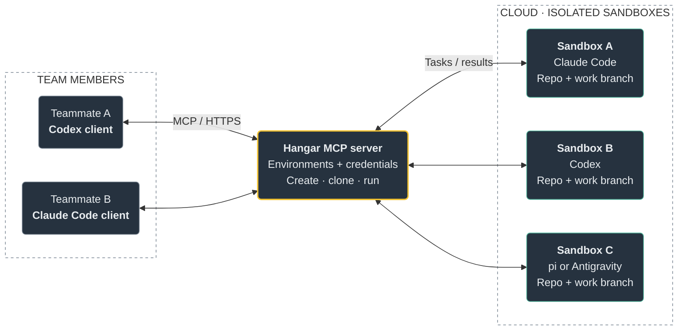

# Hangar

**A control plane for isolated, cloneable coding-agent sandboxes.**

Hangar manages sandboxes for Claude Code, Codex, pi, and Antigravity. Each sandbox gets its own files, tools, repository checkout, and agent configuration. Connect an MCP client to ask for work in plain language, or use the CLI and browser dashboard.

Start on a laptop with Docker. The same control plane also supports Kubernetes and E2B.

[Quick start](#quick-start) · [First task](#run-your-first-task) · [Environments](#create-your-own-environment) · [Documentation](#documentation)

## How it works

**One shared MCP server. Multiple teammates. A fleet of isolated coding agents.**

Each teammate connects their own client to Hangar. From that client, they can create a workspace, start an agent, or fork a prepared sandbox into parallel attempts.



The client on a teammate's machine and the agent inside a sandbox are separate choices: a Codex client can ask Hangar to run Claude Code, for example. All clients connect to the same `/mcp` endpoint; Hangar manages the sandboxes behind it.

| Feature | What it gives your team |
| --- | --- |
| **Connect from your own tools** | Use Codex, Claude Code, Cursor, or another [MCP client](docs/clients.md) with a client token or supported OAuth sign-in. |
| **Prepare once, run in parallel** | Define tools, dependencies, and repo setup in an [environment](#create-your-own-environment). Create separate sandboxes or fork a prepared workspace into multiple attempts. |
| **Keep workspaces separate** | Each sandbox has its own files, agent configuration, and repo checkout. Give parallel attempts separate work branches and choose which stored credentials each receives. |
| **Watch, steer, and review** | Follow live terminals in the dashboard, [steer supported agents](docs/steering.md), and review changes and test output. [Jobs](docs/jobs.md) support verification and draft PR delivery; [sessions](docs/sessions.md) preserve context across turns. |

Run the cloud fleet on a Docker VM, Kubernetes, or E2B. The same control plane also runs locally with Docker. See [deployment options and limits](#deployment-and-limits).

An **environment** is a reusable workspace recipe. A **sandbox** is a running copy. A **harness** is the agent CLI inside it.

## Quick start

You need a running [Docker](https://docs.docker.com/get-started/get-docker/) installation and [uv](https://docs.astral.sh/uv/getting-started/installation/). Hangar requires Python 3.12 or newer; uv manages the project environment.

Run these commands from the repository root:

```bash
git clone https://github.com/Sean-Koval/hangar.git
cd hangar
uv sync --all-extras
uv run hangar up
```

Hangar starts the server, saves your CLI login, builds the default `claude-python` environment, and offers to connect installed MCP clients. The first build downloads tools and dependencies, so allow time for it to finish.

Open the **dashboard at [localhost:8787](http://localhost:8787)** to see your fleet, credentials, environments, and live terminals. Local state is stored in `~/.hangar`; the server log is `~/.hangar/server.log`.

### 1. Add an agent login

Use **Credentials** in the dashboard, or store an existing login from the CLI.

For Claude Code, run this on your host with the Claude CLI installed:

```bash
claude setup-token | uv run hangar cred add claude-max --harness claude-code --kind oauth_token
```

For Codex, import the auth file from a host where you have already signed in:

```bash
uv run hangar cred add codex-chatgpt --harness codex --kind auth_file --file ~/.codex/auth.json
uv run hangar env build codex-node
```

Choose the credential when creating a sandbox, or list its name in your environment's `credentials` field. Storing a login alone does not attach it to every sandbox.

Codex subscription credentials are leased to one sandbox at a time because their refresh tokens rotate. For concurrent Codex sandboxes, use separate logins or API-key credentials. Parallel agents also share their account's usage limits.

### 2. Connect your client

If startup did not connect your client, choose one:

```bash
uv run hangar connect claude-code
# Or:
uv run hangar connect codex
```

Start a new client session so it reads the updated configuration. Cursor, VS Code, Gemini CLI, and Claude Desktop are also supported. See [client setup](docs/clients.md) for all options, remote connections, and OAuth.

### 3. Check your setup

```bash
uv run hangar doctor
```

If a check fails, follow the suggested fix. `uv run hangar doctor --fix` can apply supported repairs.

## Run your first task

In your connected MCP client, ask:

> Use Hangar to create a claude-python sandbox for https://github.com/YOUR-USER/YOUR-REPO.git. Use the claude-max credential and a new work branch. Run Claude Code to explain the project structure and how to run its tests. Report the sandbox name and findings.

Replace the repository URL with your own. Start with a public repo, or add a Git credential for private repository access.

You can do the same from the CLI:

```bash
uv run hangar sb create claude-python \
  --name first-task \
  --repo https://github.com/YOUR-USER/YOUR-REPO.git \
  --work-branch hangar/first-task \
  --cred claude-max

uv run hangar sb agent first-task \
  "Explain the project structure and how to run its tests."
```

Open the sandbox in the dashboard to follow the work in its live terminal. When you finish reviewing it, remove it:

```bash
uv run hangar sb rm first-task
```

For Codex, use `codex-node` and `--cred codex-chatgpt` instead.

### Try parallel attempts

Once a single task works, ask your MCP client:

> Create three claude-python sandboxes for my repo, each on its own work branch, using claude-max. Ask each agent to fix the same flaky test, run the project's tests, and report the changes and results. Let me review the attempts before removing the sandboxes.

To start from work you have already prepared, use `snapshot_sandbox` and `fork_sandbox`. Snapshot behavior varies by provider; see [limitations](#deployment-and-limits).

For a task that should produce a draft PR, use a [job](docs/jobs.md). Jobs support verification commands, follow-ups, budgets, and GitHub triggers. [Sessions](docs/sessions.md) preserve a conversation and repository state across turns.

## Create your own environment

Save this as `envs/my-service.yaml`:

```yaml
name: my-service
extends: python
harnesses: [claude-code]
default_harness: claude-code
credentials: [claude-max]
repo:
  url: https://github.com/YOUR-USER/YOUR-REPO.git
  branch: main
  setup: uv sync
agent_config:
  instructions: |
    Run the project's tests before finishing.
resources:
  cpus: 2
  memory_gb: 4
warm_pool: 1
```

Replace the repo URL, branch, and setup command with your project's values. Then build it:

```bash
uv run hangar env build my-service
```

Ask your client to create a sandbox from `my-service`. It will use the configured repo and credential. `warm_pool: 1` keeps one sandbox pre-started for faster claims.

Built-in foundations include `bare`, `python`, `node`, `go`, and `polyglot`. Use [the environment reference](docs/guide.md#environment-specs) for additional tools, skills, secrets, MCP servers, and multiple agent choices.

## Everyday commands

Run these from the Hangar checkout:

| What you want | Command |
| --- | --- |
| List environments | `uv run hangar env list` |
| List sandboxes | `uv run hangar sb ls` |
| Run a command in a sandbox | `uv run hangar sb exec first-task "git status"` |
| Check client connections | `uv run hangar connect --list` |
| Inspect settings and their sources | `uv run hangar config list` |
| Check setup | `uv run hangar doctor` |
| Stop the local server | `uv run hangar down` |

For remote instances, run `uv run hangar login https://YOUR-HANGAR-HOST` once; fleet commands then use that server.

## Deployment and limits

| Where | Backend | Learn more |
| --- | --- | --- |
| Laptop | Docker | [Quick start](#quick-start) |
| Linux or WSL2 with microVMs | Docker + Kata | [Local microVMs](docs/local-microvms.md) |
| Single VM | Docker + gVisor or Kata | [Terraform setup](deploy/terraform/single-vm) |
| GKE | Kubernetes Agent Sandbox | [GKE deployment](docs/gke.md) |
| E2B | Firecracker microVMs | [E2B backend](docs/microvm.md) |

Hangar uses a single control-plane replica with SQLite state. Kubernetes forks copy workspace files; do not assume they preserve process memory. E2B, Pod snapshots, and Kata on GKE have not yet been validated live in the existing project reference. See [the full limitations](docs/guide.md#known-limits) and [security model](docs/security.md).

For an existing deployment, read [the upgrade guide](docs/upgrading.md) before updating.

## Documentation

| Topic | Guide |
| --- | --- |
| Client configuration and OAuth | [Connecting clients](docs/clients.md) |
| MCP tools, prompts, and waiting for work | [Using MCP](docs/mcp.md) |
| Jobs, verification, and draft PRs | [Jobs](docs/jobs.md) |
| Resumable conversations and repo state | [Sessions](docs/sessions.md) |
| Messages, interrupts, and approvals | [Steering](docs/steering.md) |
| Live command and agent events | [Streaming](docs/streaming.md) |
| Usage, cost, metrics, and traces | [Activity](docs/activity.md) · [Observability](docs/observability.md) |
| Environment specs, configuration, and operations | [Full reference](docs/guide.md) |
| Design decisions | [Specs](docs/specs/README.md) |
| Release history | [Changelog](CHANGELOG.md) |

## Development

```bash
uv sync --all-extras
uv run pytest -n 8
uv run ruff check src tests
uv run hangar serve --reload
```

Docker integration tests and the code map are in [the development reference](docs/guide.md#development). See [CI](docs/ci.md) for selecting relevant tests.

Licensed under [Apache 2.0](LICENSE).
