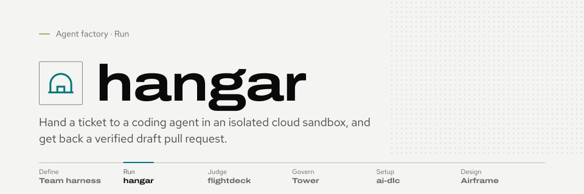
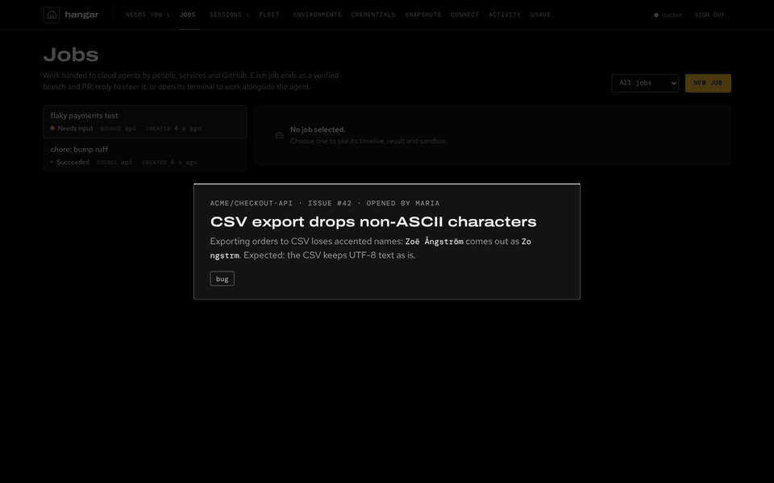
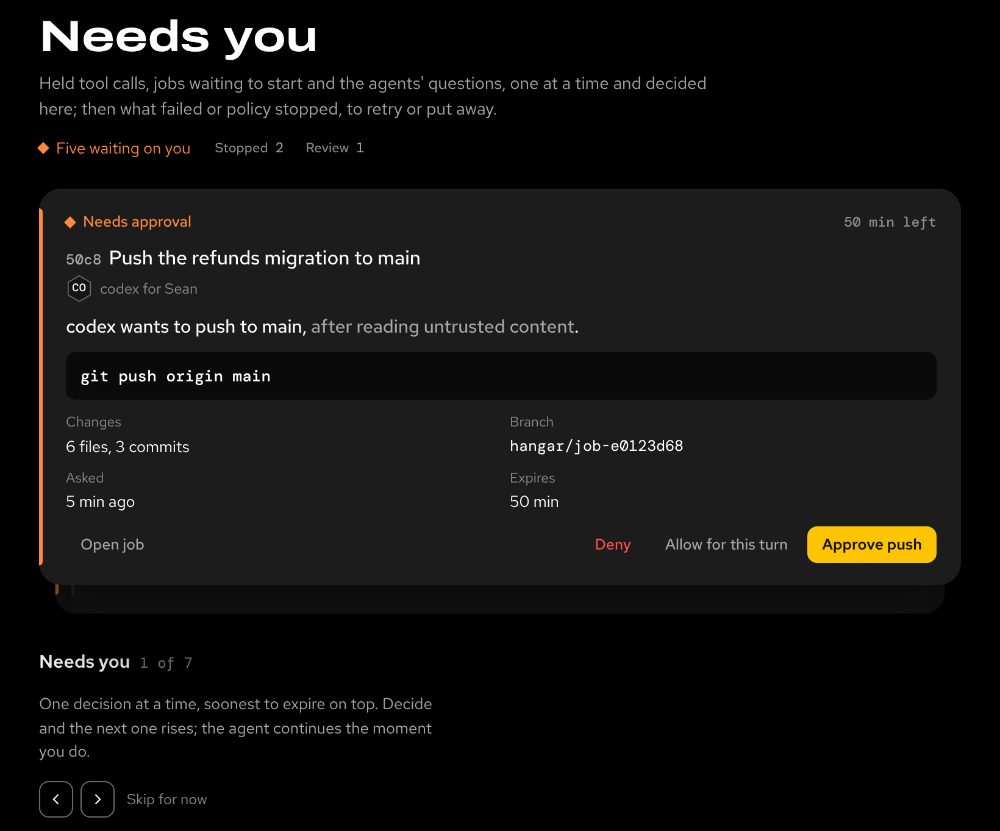
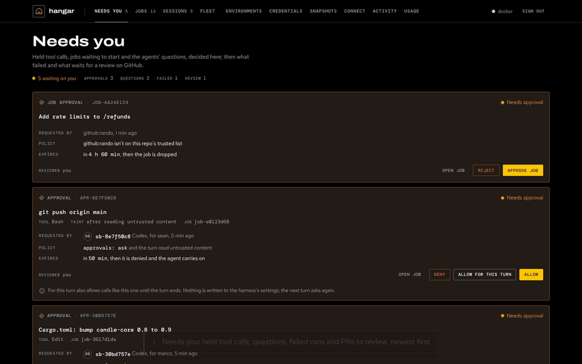
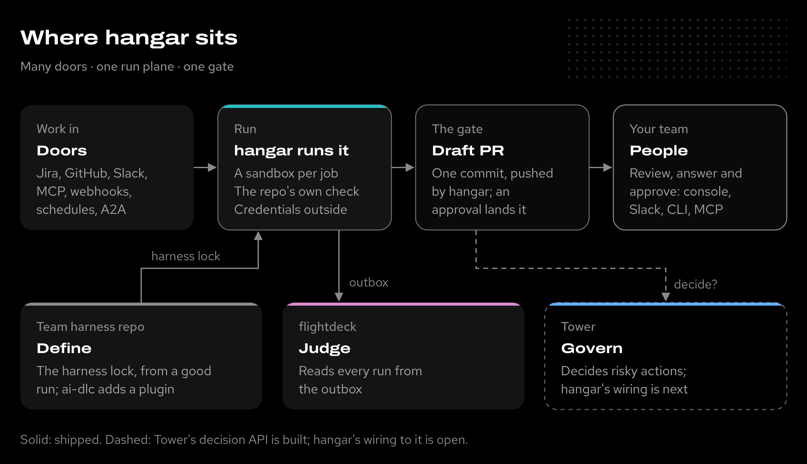

<picture>
  <source media="(prefers-color-scheme: dark)" srcset="docs/assets/brand/banner-dark.svg">
  
</picture>

# hangar

**Your team wants to hand tickets to coding agents, but not to a laptop with everyone's credentials and no record of what ran.** hangar runs Claude Code, Codex, pi and Antigravity in isolated cloud sandboxes, checks their work with your repo's own tests and hands back a draft pull request.

Documentation site: **[sean-koval.github.io/hangar](https://sean-koval.github.io/hangar/)** · part of the [agent factory](https://sean-koval.github.io/agent-factory/)



<sub>Issue #42 is labelled `hangar`; a sandbox runs the agent, the repo's check passes and draft PR #43 waits in Needs you ([MP4](docs/assets/front/hangar-demo.mp4)).</sub>

## What it looks like

The console on `:8787` opens on **Needs you**: held tool calls, jobs waiting to start and the agents' questions, decided in place; then what failed and what waits for review. [The web console](docs/console.md) walks through it, the Jobs and Sessions pages and the Fleet.

<picture>
  <source media="(prefers-color-scheme: light)" srcset="docs/assets/front/ui-needs-light.png">
  
</picture>

The **review loop**: decide what is held, read the agent's change as a greyscale diff, and comment on a line; the comment goes back to the agent with your next message.



<sub>A held edit allowed for this turn, then the held push's job: its diff, and a comment on a line sent back to the agent ([MP4](docs/assets/front/hangar-review.mp4)).</sub>

## Where it sits

Many doors bring work in; hangar runs it; the pull request is the one gate out. Around it, the team harness repo defines the harness (ai-dlc adds an optional workflow plugin), flightdeck judges the runs and [Tower](https://sean-koval.github.io/agent-factory/tools/workspace/), the Govern plane, decides risky actions: its decision API is built, and hangar's wiring to it is next on the [roadmap](https://sean-koval.github.io/agent-factory/roadmap/#p2-adopt-and-capture) ([spec 0015](docs/specs/0015-governance-decision-point.md)).

<picture>
  <source media="(prefers-color-scheme: light)" srcset="docs/assets/front/hangar-suite-light.png">
  
</picture>

## Use cases

- **Ticket to draft PR.** A product engineer labels a Jira or GitHub issue `hangar` (or moves it to "Ready for agent"). hangar starts a sandbox from the repo's environment, the agent fixes it, hangar runs the repo's check and opens a draft PR that closes the issue. The engineer reviews a PR, not a chat log.
- **Delegate from your own agent.** A developer in Claude Code or Codex says "hand this to the cloud" with the [hangar skill](skills/hangar/SKILL.md). Their uncommitted changes go along; three attempts run in parallel (`best_of_n`); they pick the best and pull its patch back, while their laptop stays free.
- **One fleet for the team.** A platform engineer runs one hangar on GKE. Everyone connects their own client with their own token; credentials stay behind a gateway, budgets and fairness cap spend, and the inbox brings each person their reviews, approvals and agents' questions.

## Quickstart

You need [Docker](https://docs.docker.com/get-started/get-docker/) and [uv](https://docs.astral.sh/uv/getting-started/installation/) (Python 3.12+ is managed by uv).

```bash
git clone https://github.com/Sean-Koval/hangar.git && cd hangar
uv sync --all-extras
uv run hangar up        # server, CLI login, the claude-python environment, MCP clients
uv run hangar cred add claude-api --harness claude-code --kind api_key --file anthropic-key.txt
uv run hangar doctor    # every check passes, or names its fix
```

`hangar up` connects your MCP clients (`hangar connect <client>` does it later): `hangar` (`/mcp`) hands work off as jobs and sessions, and `hangar-sandbox` (`/mcp/sandbox`, added for Claude Code and Codex) drives sandboxes by hand ([two servers](docs/mcp.md#two-servers)).

Open the dashboard at [localhost:8787](http://localhost:8787) and ask your MCP client: *"Use hangar to fix the failing test in https://github.com/YOU/REPO and open a draft PR."* Use an API key with a spend limit; subscription logins are for your own interactive sessions only ([why](docs/team.md#subscription-logins)).

To look around first without Docker or a key, run the demo hangar the recording uses: `uv run python docs/assets/front/demo.py`, then `uv run python docs/assets/front/demo.py ticket` in another terminal.

[Getting started](docs/guide.md#credentials) continues with credentials, a first task, parallel attempts, your own environment and everyday commands.

## Features

| Feature | What it gives your team | Status |
| --- | --- | --- |
| **Many front doors** | MCP clients, the CLI, REST, GitHub issues and Projects, Jira, Slack, webhooks, schedules and A2A all become [jobs](docs/jobs/README.md) or [sessions](docs/sessions.md), with one [repo policy](docs/repo-policy.md) for each repo. | Shipped |
| **Isolated sandboxes** | Each has its own files, tools, checkout and agent configuration, from [environments](docs/environments.md) you prepare once; fork a prepared one into parallel attempts. Docker, gVisor or Kata, GKE or E2B. | Shipped |
| **Any agent** | Claude Code, Codex, pi and Antigravity as [harnesses](docs/harnesses.md), pinned by version; a Codex client can ask for Claude Code and the other way round. A team shares one harness (instructions, skills, Claude Code plugins) frozen from a good run into a [harness repo](docs/harness-lock.md#the-team-harness-repo). | Shipped |
| **Verified delivery** | The repo's own check runs before anything is pushed; hangar pushes through the git gateway and opens a draft PR with a review packet; with [landing](docs/landing.md), an approval lands it. | Shipped |
| **People in the loop** | [Steer](docs/steering.md) a running agent, answer its questions where it asked (the ticket, the Slack thread, MCP), watch its terminal; the inbox and the [web console](docs/console.md) show what needs you. | Shipped |
| **Resumable sessions** | The conversation and repo state survive the sandbox; come back days later or fork a session. | Shipped |
| **Hostile-sandbox security** | Credentials stay behind a gateway; intake jobs get an egress allowlist and no push rights; tainted work opens as a draft and needs a second person. See the [security model](docs/security/README.md). | Shipped |
| **Usage and insight** | Tokens, cost and budgets per job and person ([activity](docs/activity.md)), traces as OTLP ([observability](docs/observability.md)), and run capture for [flightdeck](docs/specs/0014-sister-tool-interfaces.md). | Shipped |
| **Shadow runs** | A repo policy samples real tickets and runs a candidate harness on each at the same base commit; it delivers nothing, and flightdeck grades it against what people merged ([shadows](docs/repo-policy.md#shadows)). | Shadow |
| **Governed approvals** | Job release, landing and risky tool calls ask [Tower](https://sean-koval.github.io/agent-factory/tools/workspace/), the Govern plane, which decides and signs a receipt; hangar enforces and fails closed. Today hangar's own approval rule decides; the client and contract are built ([spec 0015](docs/specs/0015-governance-decision-point.md)). | Planned ([roadmap](https://sean-koval.github.io/agent-factory/roadmap/#p2-adopt-and-capture)) |
| **Overnight lane** | One Spot node kept up while the sandbox pools are powered down (01:00–10:00) for the intake jobs of repos that opt in and for evals, so evening tickets become PRs by morning; off until an admin turns it on ([the overnight lane](docs/gke.md#the-overnight-lane)). | Shipped |
| **Plugins and events out** | Doors, trackers, notifiers and deliverers are plugins: a package of your own adds a chat bot's door or a company tracker without changing hangar, and every job change goes out as a signed `hangar.event/v1` ([plugins](docs/plugins.md)). | Shipped |
| **Deploy on your company's cluster** | Kustomize base and components, a Terraform module that never creates a cluster, released images, secrets from your secret manager and admin configuration as reviewed files (`hangar apply`) ([company deploy](docs/deploy-company.md)). | Shipped |
| **Bots that act for people** | A chat bot's relay token submits work as the linked person who asked, with their rights and audit trail, never more ([relay](docs/clients.md#bots-that-act-for-people-relay)). | Partial |

*Shipped*: on main, on by default or behind a setting. *Shadow*: built, and runs beside real work without changing what people get. *Partial*: built and tested; its wiring is in progress (the relay: `/mcp` doesn't accept relay tokens yet). *Planned*: next on the [roadmap](https://sean-koval.github.io/agent-factory/roadmap/#p2-adopt-and-capture).

## Security posture

hangar treats every sandbox as hostile. A job from an intake door (a GitHub issue, Jira, GitHub Projects, Slack, an inbound webhook) can fetch its repo but never push: hangar pushes the commit it verified, through the git gateway. Its network is an egress allowlist (its environment's and repo policy's hosts and its model API), the agent has no sudo, and automated work never uses a subscription login. Once an agent has read untrusted content, its PR opens as a draft and a second person, not the requester, must approve it to land. See [the security model](docs/security/README.md) and [the safe-release upgrade](docs/releases/safe-release.md).

For an existing deployment, read [the upgrade guide](docs/upgrading.md) before updating. To deploy from GitHub Actions with your approval instead of from a laptop, see [deploying from CI/CD](docs/cicd.md).

## Documentation

| Topic | Guide |
| --- | --- |
| First task, everyday commands, deployment and limits | [Getting started](docs/guide.md) · [Where it runs](docs/guide/where-it-runs.md) · [Concepts](docs/concepts.md) |
| Environments and onboarding a team | [Environments](docs/environments.md) · [Onboarding runbook](docs/runbooks/onboarding.md) |
| Clients, OAuth and MCP tools | [Connecting clients](docs/clients.md) · [Using MCP](docs/mcp.md) |
| Jobs, sessions, steering, landing | [Jobs](docs/jobs/README.md) · [Sessions](docs/sessions.md) · [Steering](docs/steering.md) · [Landing](docs/landing.md) |
| A team on one hangar, and GKE | [Team setup](docs/team.md) · [Running on GKE](docs/gke.md) · [Upgrading](docs/upgrading.md) |
| Security and design decisions | [Security model](docs/security/README.md) · [Specs](docs/specs/README.md) |
| Release history | [Changelog](CHANGELOG.md) |

**Developing hangar:** `uv sync --all-extras && uv run pytest -n 8 && uv run ruff check src tests`; see [development](docs/guide/configuration.md#development) and [CI](docs/ci.md). To re-render the images on this page after a console change, see [the front-page assets](docs/assets/README.md).

Licensed under [Apache 2.0](LICENSE).
