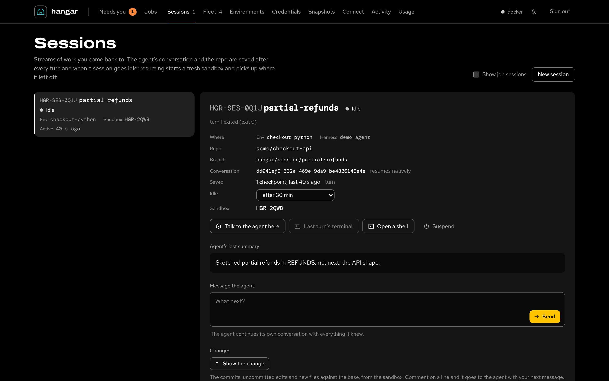
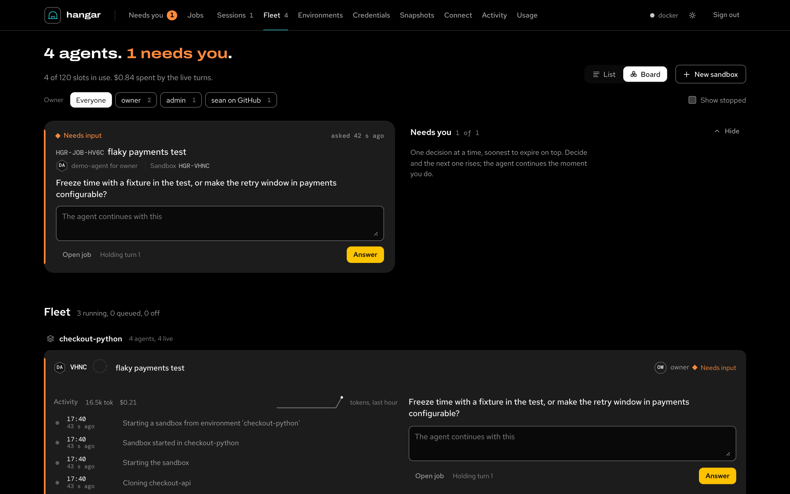

# The web console

The control plane serves a web console on the same port as the API, `:8787` by default (`HANGAR_PORT`). Open it,
paste an API token, and it shows the fleet. The server prints a bootstrap admin token when it first starts and saves
it to `~/.hangar/bootstrap-token` (in its data directory). The console uses an admin's routes, so use an admin token;
the token stays in that browser until you choose **Sign out**.

The top bar's first four sections are where the work happens, and this page covers them: **Needs you** (what waits on
a person), **Jobs**, **Sessions** and **Fleet** (every agent, as a list or a board), each with a count. The other six are
Environments, Credentials, Snapshots, Connect (MCP snippets and API tokens), Activity (the audit log, filtered by who and
action) and Usage (spend,
budget stops). The Fleet and Needs you stay current from `GET /api/fleet/stream` (every 4 seconds when the stream is not available); the other open sections refresh every 4 seconds while the browser tab is visible, and the Needs-you count
about every half minute elsewhere. On a phone (below 760 px) the first four sections move to a bottom tab bar, and the
other six, with the providers' state, sit under **More**.

The console follows the browser's light or dark setting. Terminals are always dark.

## Needs you

Everything waiting on a person, from the same list `hangar inbox`, Slack and MCP clients get (`GET /api/inbox`): your
own work, and for an admin also the work nobody in particular owns, such as jobs from GitHub issues and Slack. The page
reads it with the Fleet (`GET /api/fleet` carries the inbox, and its stream keeps it current).

<figure class="af-figure af-figure--lead">

<figcaption>A held git push to main on top of the deck: its command, its changes and when it expires, with Deny, Allow for this turn and Approve push.</figcaption>
</figure>

It is a **deck**: one decision at a time, the soonest to expire on top, the next two peeking behind it, "1 of 7",
previous and next, and an up-next list to jump to any of them. Decisions (a person is needed now) come before what
stopped. Deciding happens on the card; a verdict line says what happened ("Approved by Sean; codex is running git push
origin main"), the agent's row on the Fleet flips at once, and after a few seconds the card slides away and the next
one rises. If someone else decided first, or the wait expired, the card says so and goes. The kinds:

- **A held tool call**: a running turn under `approvals: ask` wants to run a command. The card shows the exact
  command, which agent asked and in which sandbox, for whom and how long ago, the policy that held it (and whether the
  turn read untrusted content), and when it expires and what happens then (it is denied and the agent carries on).
  **Approve**, **Allow for this turn** (also allows calls like this one until the turn ends; nothing is written to the
  agent's settings, so the next turn asks again) or **Deny**.
- **A job waiting to start**: from someone the team doesn't trust, for example, or held by a daily spend cap; the card
  says why. **Approve** or **Deny**. Approving follows the same rule as every other approval path, so you can't
  approve your own work ([security](security/README.md)).
- **A request** an agent made for access (an environment request): **Approve** or **Deny**.
- **A question** the agent asked: type an answer (or pick one of the options it offered) and **Answer**. The answer
  goes back as the agent's next message.

- **A failed job** (in the last week): **Retry** continues the same session, so the agent keeps its context and
  branch and re-runs the check that failed (`POST /api/jobs/{id}/retry`); **Start over** is a new job with the same
  task from the base branch (`?fresh=1`); **Acknowledge** puts it away.
- **A step policy denied** in a turn still running (`denied`): the agent was told and carries on without it; nothing
  to decide, so **Acknowledge**.

**Deny** needs a reason: the field opens in the card, an empty one is refused, and the reason goes back
to the agent or the requester. **Open job** or **Open session** shows the work first. **Acknowledge**
(`POST /api/inbox/{id}/ack`) puts a failed or denied item away for a week; a decision never goes that way. Below the
deck are the PRs waiting for your review on GitHub, with **Open job** and **Open PR**. With nothing waiting, the deck
says so and counts what is running. The **Needs you** count turns orange while a decision waits.

The same deck sits at the top of the Fleet, and each decision also opens with its agent there and on its job's or
session's page, as the same card.

## Jobs

<figure class="af-figure af-figure--lead">

<figcaption>Issue #42's job, opened: who asked, where it ran, the branch, draft PR #43, the check that passed and the agent's summary.</figcaption>
</figure>

Work handed to cloud agents by people, services and the [front doors](intake.md). The list filters by **In progress**,
**Succeeded**, **Failed** or **Cancelled**. **New job** submits one with its instructions, environment, agent, model,
repo, base branch, check command (**Check with**), what to deliver (draft PR, PR, branch only, or nothing) and minutes
per turn, plus context files and links. Files go to `~/.hangar/jobs/<job>/` beside the repo, never into it.

A job shows its agent's Fleet status, **Denied** included.

Choose a job to see what waits on you (its cards, above), then:

- who asked and through which door, where it runs (environment, agent, model), its repo and branch, the pull request
  and the check's result;
- the agent's summary and, when the check failed, its output;
- the agent's question, or the message box (below);
- **Changes**: **Show the change** reads the commits, uncommitted edits and new files against the base, from the
  sandbox or its last checkpoint, as a diff per file. **Comment** on a line, and the comments go to the agent with your
  next message, each with its file, line and the line itself; **Send comments** sends them on their own;
- **Decisions**: the tool calls decided in the running turn, allowed or denied, with the reason and who decided;
- **Activity**: what the agent did (messages, tool calls, commands, file changes), with tokens and cost;
- the **Timeline** of the job's events, its **Turns**, and its **Instructions**.

**The message box.** While the agent's turn is running, the box steers it: the message applies after the current
tool call, and shows as queued until the agent has it. A one-shot agent can't take a message mid-turn, and the box
says so. Once the job has finished, **Reply to the agent** runs another turn in the same sandbox and branch, and the PR
updates; a job whose sandbox was released resumes from its last checkpoint. Ctrl+Enter (⌘+Enter) sends.

While a job runs, **Watch the agent** opens the agent's own terminal, **Open a shell** opens another one in the same
sandbox, and **Cancel job** stops the agent after you confirm; work committed so far stays in the sandbox and on the
branch. See [jobs](jobs/README.md) and [steering](steering.md).

## Sessions

<figure class="af-figure af-figure--lead">

<figcaption>A session, opened: its sandbox, its saved conversation and the checkpoint it resumes from.</figcaption>
</figure>

Streams of work you come back to. The list shows your own sessions; **Show job sessions** adds the ones jobs run in.
**New session** takes a name, an environment, an agent and an optional first message. Without a message the sandbox
just opens.

A session's panel shows what waits on you (its cards, or the agent's question), its conversation (resumed natively, or
by a summary handoff), its checkpoints and its idle setting: suspend after 15 minutes, 30 minutes, 2 hours or 8 hours
idle, or stay up until you suspend it. Then **Changes**, **Decisions**, **Activity** and **Turns**, as on a job. From
there:

- **Message the agent**: an idle or suspended session starts a turn (a suspended one resumes first). While the agent
  is busy, your message queues and applies after the current tool call; until the agent has it, the queued row has a
  × to take it back.
- **Resume** (or **Open**, before anything was saved) starts a fresh sandbox from the last checkpoint.
- **Talk to the agent here** resumes the agent's conversation interactively in a terminal, between turns.
- **Last turn's terminal**, **Open a shell** and **Suspend** (save, then release the sandbox).

A session that carries a job takes its messages on the job. See [sessions](sessions.md).

## Fleet

Every agent, whoever started it: a job, a session, or a person directly. The headline counts the fleet ("26 agents. 5 need
you, 3 stopped."), with how many of the hangar's slots (`HANGAR_MAX_SANDBOXES`) are in use and
what the live turns spent. **New sandbox** starts one or more identical sandboxes from an environment, each on its own
numbered work branch; **Show stopped** adds stopped sandboxes; the **Owner** chips keep one person's agents
(`?owner=`, kept in the URL as `#fleet?owner=priya`).

<figure class="af-figure af-figure--lead">

<figcaption>The Fleet's List: the headline, the deck as a band, and each agent's status, work, now-line, owner, model, stage rail and spend.</figcaption>
</figure>

Under the header is the **deck** from [Needs you](#needs-you), as a band you can hide (it remembers), then every agent
grouped by environment, attention first: what needs you, failed, denied, running, queued, spun down. Two views of
the same agents with one selection, kept in the URL (`#fleet?view=board`) and remembered:

- **List** (the default): one row per agent. Its status mark, its sandbox's tail number (`8AS5`),
  the work's title, and what it is doing **now** ("running pytest -q", "editing api/orders.py",
  "waiting on you: push to main") with a heartbeat: the time since it last did something, breathing while it runs
  and orange while it waits on a person. Then the owner, the agent and model, the **stage rail** (plan, edit, test,
  PR), the last two stages' times, a sparkline of its tokens over the last hour, and its spend.
- **Board**: the same agents as cards: the agent, the tail number, a stage ring, the work, the now-line, a stage
  capsule, and the owner with the status word or the heartbeat.

<figure class="af-figure af-figure--lead">

<figcaption>The Board, with one agent opened in place into its console.</figcaption>
</figure>

IDs show as tail numbers (`HGR-8AS5`); hover or copy one for the real ID.

The rail fills solid only when the agent reported its progress (`hangar-agent progress --pct`). Otherwise the current
stage is dotted and its head hollow: the server's estimate from how long the stage usually takes, labelled "about
45% (estimate)". Rows and cards update in place as the agents work; nothing moves under the pointer.

### An agent, opened

Select a row or card (or press Enter on it) and it opens in place. First the **decision**, when one waits, decided
here as on the deck. Then **now**: the now-line with its heartbeat, the labelled rail, the owner, agent, model, repo,
the sandbox, branch, age, spend and lease, and every sandbox action. Then the **activity**: the files, commits, tokens and spend so
far, the token sparkline, and a timeline with the wall-clock time and how long ago: the stages, the job's own steps,
and what the agent ran, edited, reported, asked or hit (a run of edits is one line). Only the opened agent is
followed live.

**Sandbox actions.** On a running sandbox: **Terminal** (a shell), **Run agent** (a headless agent on a task, in its own
terminal, which opens), **Run command**, **Fork** (snapshot it and start copies with the same files, dependencies and
repo state), **Snapshot**, **Pause** and **+1 h** on its lease. A paused one offers **Resume** and **+1 h**. Every
sandbox that isn't stopped has **Destroy**. **Open job** or **Open session** goes to the work's own page.

### The status key

Every status is a mark, a word and, for the three that need someone, a color. Running work stays grey on purpose: a
screen with no color on it needs nobody.

| Status | Mark | When |
| --- | --- | --- |
| Running | grey dot | the sandbox is up and its work is going on |
| Queued | ring | the sandbox is pending or starting |
| Needs you (needs approval, needs input) | orange diamond | a job waits for approval to start, a running turn waits for a tool call to be allowed, or the agent asked a question |
| Failed | red triangle | the sandbox stopped on an error, or its job failed |
| Denied | red placard | policy denied a step in the running turn |
| Spun down | small dot | paused, stopping or stopped |

The brand yellow marks focus and the primary action, never a status.

### Keyboard

- The agents are one tab stop. **Arrow keys** move between rows and cards, across environments; **Home** and **End**
  go to the first and last.
- **Enter** (or **Space**) opens the focused agent in place; **Escape** closes it, and focus returns to its row.
- On the deck, **Previous** and **Next** move through the decisions; **Ctrl+Enter** (⌘+Enter) in a reason or an
  answer sends it.

Focus, scroll and a half-written answer or reason survive every update. A screen reader hears how many need you,
failed or were denied whenever that changes.

### The data

The page is one read, `GET /api/fleet`, kept current by its stream, `GET /api/fleet/stream`; both are described in
[the Fleet API](api/fleet.md).

## Terminals

Terminals open in a drawer at the bottom of the console, one tab each; drag its top edge to resize it. Opening an
agent run attaches to the same terminal the agent uses: you see what it types and can type back. **Terminal** opens a
plain shell; to switch to a terminal an agent or an MCP client is using, choose **Sessions…**, pick it and **Attach**.
A closed connection reconnects when you press Enter. Escape inside a terminal goes to the program running there (vim,
less), not to the console.

## Hide, Destroy and Snapshot

- **Hide**, in the terminal drawer, only hides the drawer. The terminals stay open and the sandbox keeps running.
  Close a terminal with its tab's ×.
- **Destroy**, in an opened agent, deletes the sandbox and its filesystem, after you confirm, and closes its
  terminals. Push or save what you want to keep first. A job's branch and a session's conversation are kept: a
  session's sandbox is checkpointed before it goes, so the session suspends and resumes later from that checkpoint.
- **Snapshot** keeps the sandbox's state without stopping it: a full snapshot where the provider has them, otherwise
  the workspace's files. Snapshots are listed under **Snapshots**, where **Start copy** starts a new sandbox from one.
  Take one before you destroy a sandbox whose files you may need.

From the CLI, `hangar sb rm <name>` removes a sandbox.
