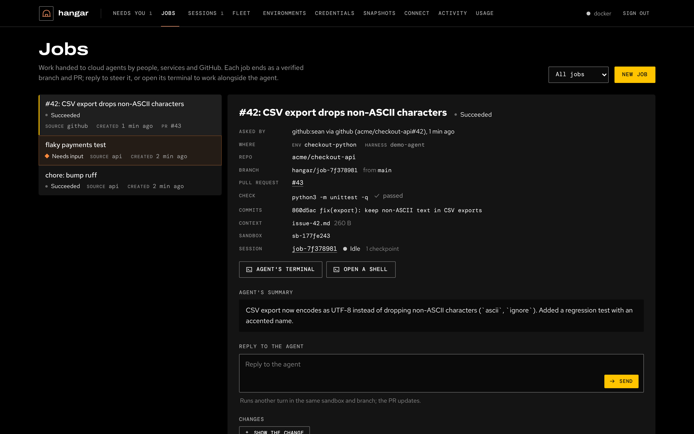
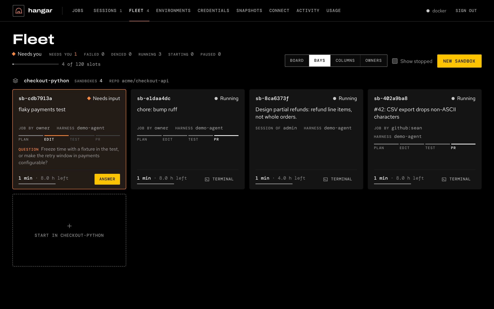
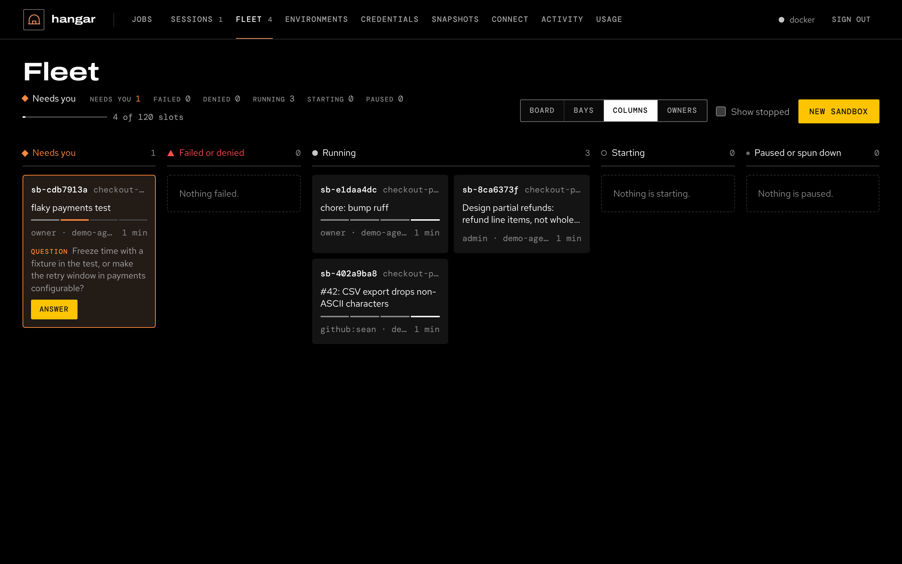
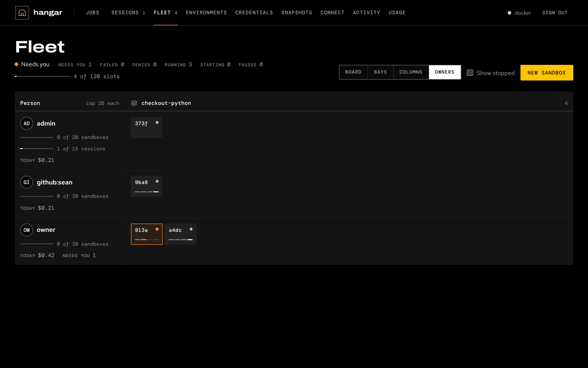

# The web console

The control plane serves a web console on the same port as the API, `:8787` by default (`HANGAR_PORT`). Open it,
paste an API token, and it shows the fleet. The server prints a bootstrap admin token when it first starts and saves
it to `~/.hangar/bootstrap-token` (in its data directory). The console uses an admin's routes, so use an admin token; the token stays
in that browser until you choose **Sign out**.

Its top bar has nine sections: **Jobs**, **Sessions**, **Fleet**, **Environments**, **Credentials**, **Snapshots**,
**Connect** (MCP snippets and API tokens), **Activity** (the audit log) and **Usage** (spend, budget stops). This page
covers the first three, where the work happens. The Jobs, Sessions and Fleet tabs carry counts: active jobs, live
sessions and live sandboxes. Jobs, Sessions and Fleet refresh every 4 seconds while the browser tab is visible.

The console follows the browser's light or dark setting. Terminals are always dark.

## Jobs

Work handed to cloud agents by people, services and the [front doors](intake.md). The list filters by **In progress**,
**Succeeded**, **Failed** or **Cancelled**. **New job** submits one with its instructions, environment, agent, model,
repo, base branch, check command (**Check with**), what to deliver (draft PR, PR, branch only, or nothing) and minutes
per turn, plus context files and links. Files go to `~/.hangar/jobs/<job>/` beside the repo, never into it.

Choose a job to see:

- who asked and through which door, where it runs (environment, agent, model), its repo and branch, the pull request
  and the check's result;
- the agent's summary and, when the check failed, its output;
- **Activity**: what the agent did (messages, tool calls, commands, file changes), with tokens and cost;
- the **Timeline** of the job's events, its **Turns**, and its **Instructions**.

While a job runs, **Watch the agent** opens the agent's own terminal, **Open a shell** opens another one in the same
sandbox, and **Cancel job** stops the agent (work committed so far stays in the sandbox). When it has finished, **Reply
to the agent** runs another turn in the same sandbox and branch, and the PR updates. A job whose sandbox has been
released resumes from its last checkpoint. See [jobs](jobs.md).

## Sessions

Streams of work you come back to. The list shows your own sessions; **Show job sessions** adds the ones jobs run in.
**New session** takes a name, an environment, an agent and an optional first message. Without a message the sandbox
just opens.

A session's panel shows its conversation (resumed natively, or by a summary handoff), its checkpoints and its idle
setting: suspend after 15 minutes, 30 minutes, 2 hours or 8 hours idle, or stay up until you suspend it. From there:

- **Message the agent**: it continues its own conversation. A suspended session resumes first.
- **Resume** (or **Open**, before anything was saved) starts a fresh sandbox from the last checkpoint.
- **Talk to the agent here** resumes the agent's conversation interactively in a terminal, between turns.
- **Last turn's terminal**, **Open a shell** and **Suspend** (save, then release the sandbox).

See [sessions](sessions.md).

## Fleet

Every sandbox, whoever started it: a job, a session, or a person directly. The page header leads with what needs you:
the loudest status present, the count of each status, and how many of the hangar's slots (`HANGAR_MAX_SANDBOXES`) are
in use. **Show stopped** adds stopped sandboxes; **New sandbox** starts one or more identical sandboxes from an
environment, each on its own numbered work branch.

The same sandboxes are shown four ways, with one selection shared by all four. The view is kept in the URL
(`#fleet?view=bays`) and remembered by the browser.

### Board

Every sandbox at a glance: one small tile per sandbox, grouped by environment, labelled with the last four characters of
its id. A tile shows its status mark and, while the work has a stage, four pips for plan, edit, test and PR. Tiles are
ordered by attention: what needs a person, then failed, then denied, then the quiet states. Hover for the sandbox's
name, status, reason and task. On a wide screen the detail panel sits beside the Board; elsewhere it opens as a drawer.

### Bays

A card per sandbox you can read and act on: its id and status, the job's or session's title, who it belongs to and the
agent, the stage track, the reason it needs you (a question, a held step, a failure), its age and the time left on its
lease, and one action. Each environment ends with a **Start in** card.

### Columns

One column per state, attention on the left: **Needs you**, **Failed or denied**, **Running**, **Starting**, and
**Paused or spun down**. Cards in the first two columns show why, and their action.

### Owners

People down, environments across. Each row shows the sandboxes the person started directly and their live sessions,
against the per-person caps (`HANGAR_PERSON_MAX_SANDBOXES`, `HANGAR_PERSON_MAX_SESSIONS`), what they spent today, and
how many of theirs need someone. Sandboxes hangar started for itself sit in a `hangar` row. See
[team scale](team-scale.md) for the caps.

### The status key

Every status is a mark, a word and, for the three that need someone, a color. Running work stays grey on purpose: a
screen with no color on it needs nobody.

| Status | Mark | When |
| --- | --- | --- |
| Running | grey dot | the sandbox is up and its work is going on |
| Starting | ring | the sandbox is pending or starting |
| Needs you (needs approval, needs input) | orange diamond | a job waits for approval to start, a running turn waits for a tool call to be allowed, or the agent asked a question |
| Failed | red triangle | the sandbox stopped on an error, or its job failed |
| Denied | red placard | policy denied a step in the running turn |
| Paused or spun down | small dot | paused, stopping or stopped |

The brand yellow marks the selected tile, focus and the primary action, never a status.

### The detail panel

Select a sandbox in any view to open its detail panel. It holds every action, so all four views get the same ones. It
shows the reason the sandbox needs you, its stage, its name, the job or session it belongs to (a link) and whose it is,
where it runs (environment, provider, agent, model), its age and lease, repo, branch, credentials, the sandbox it was
forked from, and its task.

**Deciding a hold.** When a sandbox needs approval, the panel shows what is held and two buttons:

- a job waiting for approval to start (from someone the team doesn't trust, for example, or held by a daily spend cap;
  the panel says why): **Approve job** queues it, **Deny** rejects it after you confirm, and it won't run;
- a tool call a running turn asked for under `approvals: ask`: the command is shown, and **Allow** or **Deny** answers
  it. A denied call goes back to the agent, which carries on.

Approving a job follows the same rule as every other approval path, so you can't approve your own work
([security](security.md)). For an agent's question, **Answer the agent** opens its job or session, where you reply.

**Sandbox actions.** On a running sandbox: **Terminal** (a shell), **Run agent** (a headless agent on a task, in its own
terminal, which opens), **Run command**, **Fork** (snapshot it and start copies with the same files, dependencies and
repo state), **Snapshot**, **Pause** and **+1 hour** on its lease. A paused one offers **Resume** and **+1 hour**. Every
sandbox that isn't stopped has **Destroy**. The panel also lists the sandbox's last agent runs; choose one to attach to
its terminal.

### Keyboard

- Each view is one tab stop. **Arrow keys** move between tiles by position, across environments, cells and columns;
  **Home** and **End** go to the first and last.
- **Enter** (or **Space**) opens the focused sandbox in the detail panel.
- **Escape** closes the panel where it is a drawer, and focus returns to the tile.

Focus and scroll survive the 4-second refresh. When the set of sandboxes that need someone, failed or were denied
changes, a screen reader hears how many need you and how many failed or were denied.

## Terminals

Terminals open in a drawer at the bottom of the console, one tab each; drag its edge to resize it. Opening an agent run
attaches to the same terminal the agent uses: you see what it types and can type back. **Terminal** opens a plain
shell; to switch to a terminal an agent or an MCP client is using, choose **Sessions…**, pick it and **Attach**. A
closed connection reconnects when you press Enter.

## Hide, Destroy and Snapshot

- **Hide**, in the terminal drawer, only hides the drawer. The terminals stay open and the sandbox keeps running.
  Close a terminal with its tab's ×.
- **Destroy**, in the detail panel, deletes the sandbox and its filesystem, after you confirm, and closes its
  terminals. Push or save what you want to keep first. A session's sandbox is checkpointed before it goes, so the
  session suspends and resumes later from that checkpoint.
- **Snapshot** keeps the sandbox's state without stopping it: a full snapshot where the provider has them, otherwise
  the workspace's files. Snapshots are listed under **Snapshots**, where **Start copy** starts a new sandbox from one.
  Take one before you destroy a sandbox whose files you may need.

From the CLI, `hangar sb rm <name>` removes a sandbox.
