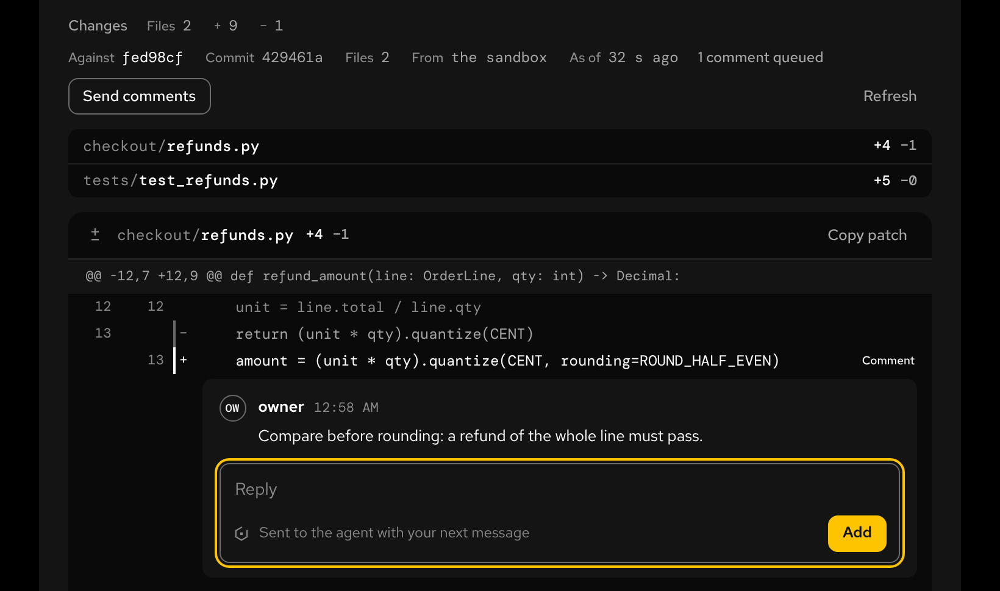

---
hide:
  - toc
---

# Guides: one page per task

Each guide answers one question about working with cloud agents: how to hand work over, follow it, review it and land
it. Pick the task; every card opens the page that does it. New to the words? Read [concepts](concepts.md) first.

<figure class="af-figure af-figure--lead">

<figcaption>Reviewing a job in the console: the diff against the base, and a comment on a line that goes to the agent with your next message.</figcaption>
</figure>

## Hand work to an agent

  <a class="af-tool" href="jobs/"><small>A task in, a draft PR out</small><b>Jobs</b>Submit work from a service, the CLI, an MCP client or a ticket. hangar runs it, checks it with the repo's own command and opens a draft PR.</a>
  <a class="af-tool" href="sessions/"><small>Work you come back to</small><b>Sessions</b>The agent's conversation and the repo state are kept; the sandbox is not. Resume days later, or fork.</a>
  <a class="af-tool" href="steering/"><small>While it runs</small><b>Steering</b>Message a running Claude Code or Codex turn, interrupt it, and approve or deny its tool calls.</a>
  <a class="af-tool" href="context-exchange/"><small>Files in, patches out</small><b>Context exchange</b>How context reaches a cloud agent from your client, and how its results come back.</a>
  <a class="af-tool" href="streaming/"><small>No polling</small><b>Streaming</b>A command's output, a session's events and file changes, sent to MCP and REST clients as they happen.</a>
  <a class="af-tool" href="changesets/"><small>Several repos</small><b>Change sets</b>One ticket whose work spans the database repo, the infrastructure repo and the code repo.</a>

## Review it and land it

  <a class="af-tool" href="landing/"><small>Approve once</small><b>Landing</b>A person reads the PR and approves it. hangar arms the merge, and GitHub's branch protection stays the gate.</a>
  <a class="af-tool" href="landing/review/"><small>What you read</small><b>The review packet and the inbox</b>What each agent PR carries for its reviewer, and how reviews, approvals and questions reach you.</a>
  <a class="af-tool" href="ai-review/"><small>Advisory</small><b>AI first-pass review</b>A first read of each non-draft agent PR before a person's. It never approves.</a>
  <a class="af-tool" href="governed-approvals/"><small>With Tower</small><b>Governed approvals</b>How hangar asks Tower, the Govern plane, before a risky call, a blocked host or a missing secret.</a>

## Bring work in

  <a class="af-tool" href="repo-policy/"><small>One record per repo</small><b>Repo policy</b>The defaults a repository's jobs get, whichever door they came through.</a>
  <a class="af-tool" href="intake/"><small>Where the team tracks work</small><b>Intake from Jira</b>A ticket moved to "Ready for agent" starts a job, and hangar keeps the ticket in step as the job runs.</a>
  <a class="af-tool" href="jobs/from-github-slack-jira/"><small>From an issue or a PR</small><b>GitHub</b>The <code>hangar</code> label on an issue, or a <code>/hangar</code> comment, starts a job.</a>
  <a class="af-tool" href="slack/"><small>From a channel</small><b>Slack</b>Type <code>/hangar</code> with instructions. The job reports in a thread, and a reply there is a follow-up.</a>
  <a class="af-tool" href="triggers/"><small>Automation</small><b>Triggers and schedules</b>Jobs from any system that sends webhooks, and on a schedule; untrusted GitHub triggers wait for approval.</a>
  <a class="af-tool" href="plugins/"><small>Your own doors</small><b>Plugins and events out</b>A package of your own adds a door, a tracker or a notifier without changing hangar.</a>

## Prepare the computer and the agent

  <a class="af-tool" href="environments/"><small>The computer</small><b>Environments</b>The image a sandbox boots from: dependencies, services, ports and the check that proves a change works.</a>
  <a class="af-tool" href="environments/repo-file/"><small>In the repo</small><b>The repo's own file</b><code>.hangar/environment.yaml</code>, committed next to the code: install, start, keep up, verify.</a>
  <a class="af-tool" href="harnesses/"><small>The agent</small><b>Harnesses</b>Claude Code, Codex, pi and Antigravity: how their versions are pinned and moved forward, and which model each runs.</a>
  <a class="af-tool" href="harness-lock/"><small>The team's setup</small><b>Harness locks</b>Freeze a harness from a turn that went well into a git directory the whole team runs.</a>
  <a class="af-tool" href="computer-use/"><small>A screen of its own</small><b>Computer use</b>The agent's own desktop, and an environment it can diagnose when something is missing.</a>
  <a class="af-tool" href="caches/"><small>Faster starts</small><b>Build caches</b>Shared dependency and compile caches, so a sandbox does not install and build from nothing.</a>

## See what it did and what it cost

  <a class="af-tool" href="activity/"><small>Per turn</small><b>Activity, usage and budgets</b>One stream of events for every harness, the tokens and money each turn used, and the budgets that stop one.</a>
  <a class="af-tool" href="observability/"><small>Per fleet</small><b>Observability</b>Traces, metrics and cost for the people who operate the factory.</a>
  <a class="af-tool" href="slos/"><small>What "up" means</small><b>SLOs and alerting</b>What hangar promises, how each promise is measured, and who hears when one is at risk.</a>
  <a class="af-tool" href="cost-reporting/"><small>For whoever pays</small><b>Cost reporting</b>What a team's agent work cost, and what it bought.</a>

## Next

Not sure a guide exists for it? [Troubleshooting](troubleshooting.md) starts from the symptom, and the
[reference](reference.md) holds the APIs and the security model. To run hangar for a team, go to
[operations](operations.md).
