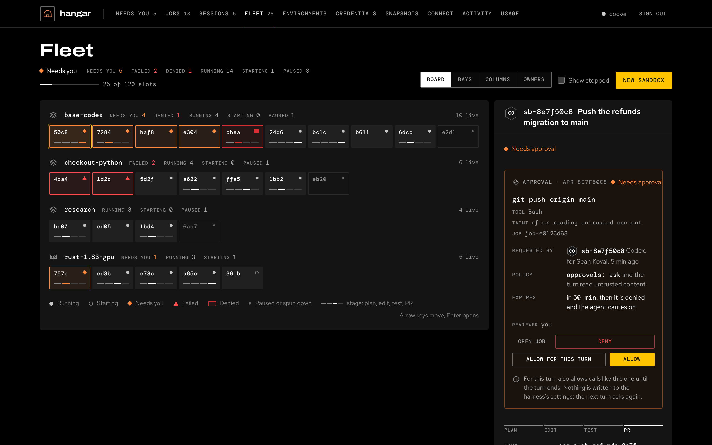

---
hide:
  - navigation
  - toc
---

<div class="af-hero af-hero--visual" markdown>
<div markdown>
<span class="af-eyebrow">Agent factory · Run plane</span>

# Hand tickets to coding agents in isolated cloud sandboxes

<p class="af-lede">Your team wants to hand tickets to coding agents, but not to a laptop with everyone's credentials and no record of what ran. Hangar runs Claude Code, Codex, pi and Antigravity in isolated sandboxes, checks their work with your repo's own tests and hands back a draft pull request.</p>

[Quickstart](#quickstart){ .md-button .md-button--primary } [Suite overview](https://sean-koval.github.io/agent-factory/){ .md-button }
</div>
<figure class="af-hero__visual">
<video src="assets/front/hangar-demo.mp4" poster="assets/front/ui-jobs.png" autoplay loop muted playsinline controls width="1440" height="900" aria-label="A GitHub issue labelled hangar becomes a job: a sandbox starts, the agent edits and tests the code, hangar verifies and opens draft PR #43, and the PR waits in Needs you with a question another job asked"></video>
<figcaption>A ticket becoming a sandbox run and a draft PR, recorded by docs/assets/front/make.py against the demo hangar</figcaption>
</figure>
</div>

## What it looks like

The console on `:8787`. **Needs you** is first: held tool calls, jobs waiting to start and the agents' questions, decided in place; then what failed and what waits for review on GitHub.


The **Fleet** four ways over the same sandboxes (**Board**, every one at a glance; **Bays**, each one's task and next action; **Columns**, sorted by what needs you; **Owners**, capacity by person); the selected sandbox's held call is decided beside it, and any sandbox's terminal opens below. [The web console](console.md) walks through it.



A **job** is issue #42's timeline, the agent's activity, the check and the draft PR; a **session** is a stream of work you come back to.


The **review loop**: decide what is held, read the agent's change as a greyscale diff, and comment on a line; the comment goes back to the agent with your next message.

<video src="assets/front/hangar-review.mp4" poster="assets/front/ui-review.png" loop muted playsinline controls width="100%" aria-label="The review loop: decide a held edit in Needs you, open the held push's job, show the change as a diff, comment on a line and send it to the agent"></video>

<small>On the fixture (`docs/assets/front/fixture.py`, a team's afternoon served over the same console). The same inbox from the CLI: `hangar inbox`.</small>


## Where it sits

Many doors bring work in; hangar runs it; the pull request is the one gate out. Hangar is the run plane of the agent factory: around it, the team harness repo defines the harness (ai-dlc adds an optional workflow plugin), flightdeck judges the runs (through [trace export](api/traces.md) and the [sister tool interfaces](specs/0014-sister-tool-interfaces.md)) and [Tower](https://sean-koval.github.io/agent-factory/tools/workspace/), the Govern plane, decides risky actions: its decision API is built, and hangar's wiring to it is open ([#172](https://github.com/Sean-Koval/hangar/issues/172), [spec 0015](specs/0015-governance-decision-point.md)). The suite's [architecture page](https://sean-koval.github.io/agent-factory/architecture/) shows how they connect.


## Use cases

- **Ticket to draft PR.** A product engineer labels a Jira or GitHub issue `hangar` (or moves it to "Ready for agent"). Hangar starts a sandbox from the repo's environment, the agent fixes it, hangar runs the repo's check and opens a draft PR that closes the issue. The engineer reviews a PR, not a chat log. See [intake](intake.md) and [jobs](jobs.md).
- **Delegate from your own agent.** A developer in Claude Code or Codex says "hand this to the cloud" with the [hangar skill](#use-the-hangar-skill). Their uncommitted changes go along ([context exchange](context-exchange.md)); three attempts run in parallel (`best_of_n`); they pick the best and pull its patch back, while their laptop stays free.
- **One fleet for the team.** A platform engineer runs one hangar on [GKE](gke.md). Everyone connects their own client with their own token; credentials stay behind a gateway, budgets and fairness cap spend, and the inbox brings each person their reviews, approvals and agents' questions. See [team setup](team.md).

## Quickstart

You need [Docker](https://docs.docker.com/get-started/get-docker/) and [uv](https://docs.astral.sh/uv/getting-started/installation/) (Python 3.12+ is managed by uv).

```bash
git clone https://github.com/Sean-Koval/hangar.git && cd hangar
uv sync --all-extras
uv run hangar up        # server, CLI login, the claude-python environment, MCP clients
uv run hangar cred add claude-api --harness claude-code --kind api_key --file anthropic-key.txt
uv run hangar doctor    # every check passes, or names its fix
```

`hangar up` starts the server, saves your CLI login, builds the default `claude-python` environment (the first build downloads tools, so allow a few minutes) and offers to connect installed MCP clients. Open the **dashboard at [localhost:8787](http://localhost:8787)** to see your fleet, credentials, environments and live terminals. Local state is in `~/.hangar`; the server log is `~/.hangar/server.log`. If a doctor check fails, follow its fix; `uv run hangar doctor --fix` applies the supported repairs.

To look around first without Docker or a key, run the demo hangar the recording uses: `uv run python docs/assets/front/demo.py` (the web UI on :8787, its token printed), then `uv run python docs/assets/front/demo.py ticket` in another terminal to label issue #42.

## Features

| Feature | What it gives your team | Status |
| --- | --- | --- |
| **Many front doors** | MCP clients, the CLI, REST, GitHub issues and Projects, Jira, Slack, webhooks, schedules and A2A all become [jobs](jobs.md) or [sessions](sessions.md), with one [repo policy](repo-policy.md) for each repo. | Shipped |
| **Isolated sandboxes** | Each has its own files, tools, checkout and agent configuration, from [environments](environments.md) you prepare once; fork a prepared one into parallel attempts. Docker, gVisor or Kata, GKE or E2B. | Shipped |
| **Any agent** | Claude Code, Codex, pi and Antigravity as [harnesses](harnesses.md), pinned by version; a Codex client can ask for Claude Code and the other way round. A team shares one harness (instructions, skills, Claude Code plugins) frozen from a good run into a [harness repo](harness-lock.md#the-team-harness-repo). | Shipped |
| **Verified delivery** | The repo's own check runs before anything is pushed; hangar pushes through the git gateway and opens a draft PR with a review packet; with [landing](landing.md), an approval lands it. | Shipped |
| **People in the loop** | [Steer](steering.md) a running agent, answer its questions where it asked (the ticket, the Slack thread, MCP), watch its terminal; the inbox and the [web console](console.md) show what needs you. | Shipped |
| **Resumable sessions** | The conversation and repo state survive the sandbox; come back days later or fork a session. | Shipped |
| **Hostile-sandbox security** | Credentials stay behind a gateway; intake jobs get an egress allowlist and no push rights; tainted work opens as a draft and needs a second person. See the [security model](security.md). | Shipped |
| **Usage and insight** | Tokens, cost and budgets per job and person ([activity](activity.md)), traces as OTLP ([observability](observability.md)), and run capture for [flightdeck](specs/0014-sister-tool-interfaces.md). | Shipped |
| **Shadow runs** | A repo policy samples real tickets and runs a candidate harness on each at the same base commit; it delivers nothing, and flightdeck grades it against what people merged ([shadows](repo-policy.md#shadows)). | Shadow |
| **Governed approvals** | Job release, landing and risky tool calls ask [Tower](https://sean-koval.github.io/agent-factory/tools/workspace/), the Govern plane, which decides and signs a receipt; hangar enforces and fails closed. Today hangar's own approval rule decides; the client and contract are built ([spec 0015](specs/0015-governance-decision-point.md)). | Planned ([#172](https://github.com/Sean-Koval/hangar/issues/172)) |
| **Overnight lane** | One Spot node kept up while the sandbox pools are powered down (01:00–10:00) for the intake jobs of repos that opt in and for evals, so evening tickets become PRs by morning; off until an admin turns it on ([the overnight lane](gke.md#the-overnight-lane)). | Shipped |
| **Plugins and events out** | Doors, trackers, notifiers and deliverers are plugins: a package of your own adds a chat bot's door or a company tracker without changing hangar, and every job change goes out as a signed `hangar.event/v1` ([plugins](plugins.md)). | Shipped |
| **Deploy on your company's cluster** | Kustomize base and components, a Terraform module that never creates a cluster, released images, secrets from your secret manager and admin configuration as reviewed files (`hangar apply`) ([company deploy](deploy-company.md)). | Shipped |
| **Bots that act for people** | A chat bot's relay token submits work as the linked person who asked, with their rights and audit trail, never more ([relay](clients.md#bots-that-act-for-people-relay)). | Partial |

*Shipped*: on main, on by default or behind a setting. *Shadow*: built, and runs beside real work without changing what people get. *Partial*: built and tested; its wiring is in progress (the relay: `/mcp` doesn't accept relay tokens yet). *Planned*: an open issue.

## Getting started

### Credentials

Use **Credentials** in the dashboard, or store a key from the CLI. Use an API key (an Anthropic Console key, an OpenAI project key, a Claude Team or Enterprise key) and set a spend limit on it in the vendor's console; hangar's own job and daily budgets cap spend inside hangar. For Codex:

```bash
uv run hangar cred add codex-api --harness codex --kind api_key --file openai-key.txt
uv run hangar env build codex-node
```

Choose the credential when creating a sandbox, or list its name in your environment's `credentials` field. Storing a key alone does not attach it to every sandbox.

Jobs, schedules, webhooks and experiments run on API keys only. A personal subscription login (Claude Pro or Max, a ChatGPT sign-in) is for your own interactive sessions, with a warning: see [subscription logins](team.md#subscription-logins).

### Connect your client

If `hangar up` did not connect your client, run `uv run hangar connect claude-code` (or `codex`). Start a new client session so it reads the updated configuration. Cursor, VS Code, Gemini CLI and Claude Desktop are also supported; see [connecting clients](clients.md) for all options, remote connections and OAuth.

### Use the hangar skill

The [hangar skill](https://github.com/Sean-Koval/hangar/blob/main/skills/hangar/SKILL.md) teaches your calling agent to turn a task or ticket into a cloud job or resumable session, follow progress, handle questions, and report changes with verification evidence.

Copy the `skills/hangar/` folder into your client's configured skills directory (for clients using the shared convention, `~/.agents/skills/hangar/`), and reload its skills. Connect that client to your hangar server as above; installing the skill alone does not connect MCP. For example:

> Use the Hangar skill to work on ticket APP-42 in my repo. Use our configured Python environment, run the project's tests, and return a draft PR with the results.

This skill runs in the client that delegates work. The separate [repo-conventions skill](https://github.com/Sean-Koval/hangar/blob/main/envs/skills/repo-conventions/SKILL.md) guides coding agents working inside sandboxes.

### First task

In your connected MCP client, ask:

> Use Hangar to create a claude-python sandbox for https://github.com/YOUR-USER/YOUR-REPO.git. Use the claude-api credential and a new work branch. Run Claude Code to explain the project structure and how to run its tests. Report the sandbox name and findings.

Replace the repository URL with your own. Start with a public repo, or add a Git credential for private repository access. The same from the CLI:

```bash
uv run hangar sb create claude-python \
  --name first-task \
  --repo https://github.com/YOUR-USER/YOUR-REPO.git \
  --work-branch hangar/first-task \
  --cred claude-api

uv run hangar sb agent first-task \
  "Explain the project structure and how to run its tests."
```

Open the sandbox in the dashboard to follow the work in its live terminal. When you finish reviewing it, remove it with `uv run hangar sb rm first-task`. For Codex, use `codex-node` and `--cred codex-api` instead.

### Parallel attempts

Once a single task works, ask your MCP client:

> Create three claude-python sandboxes for my repo, each on its own work branch, using claude-api. Ask each agent to fix the same flaky test, run the project's tests, and report the changes and results. Let me review the attempts before removing the sandboxes.

To start from work you have already prepared, use `snapshot_sandbox` and `fork_sandbox`. Snapshot behavior varies by provider; see [deployment and limits](#deployment-and-limits). For a task that should produce a draft PR, use a [job](jobs.md): jobs support verification commands, follow-ups, budgets and GitHub triggers. [Sessions](sessions.md) preserve a conversation and repository state across turns.

### Your own environment

Save this as `envs/my-service.yaml`:

```yaml
name: my-service
extends: python
harnesses: [claude-code]
default_harness: claude-code
credentials: [claude-api]
repo:
  url: https://github.com/YOUR-USER/YOUR-REPO.git
  branch: main
  setup: uv sync
agent_config:
  instructions: |
    Run the project's tests before finishing.
resources:
  cpus: 2
  memory_gb: 4
warm_pool: 1
```

Replace the repo URL, branch and setup command with your project's values, then build it with `uv run hangar env build my-service`. Ask your client to create a sandbox from `my-service`; it uses the configured repo and credential. `warm_pool: 1` keeps one sandbox pre-started for faster claims. Built-in foundations include `bare`, `python`, `node`, `go` and `polyglot`; [environments](environments.md) covers tools, skills, secrets, MCP servers and multiple agent choices.

### Everyday commands

Run these from the hangar checkout:

| What you want | Command |
| --- | --- |
| List environments | `uv run hangar env list` |
| List sandboxes | `uv run hangar sb ls` |
| Run a command in a sandbox | `uv run hangar sb exec first-task "git status"` |
| What waits on you | `uv run hangar inbox` |
| Check client connections | `uv run hangar connect --list` |
| Inspect settings and their sources | `uv run hangar config list` |
| Freeze a good turn into a harness directory ([harness locks](harness-lock.md)) | `uv run hangar harness freeze job-1a2b3c4d --turn 1 --out ../harnesses/team-default` |
| Check a harness directory against its lock | `uv run hangar harness check ../harnesses/team-default` |
| Check setup | `uv run hangar doctor` |
| Stop the local server | `uv run hangar down` |

For remote instances, run `uv run hangar login https://YOUR-HANGAR-HOST` once; fleet commands then use that server.

### Deployment and limits

| Where | Backend | Learn more |
| --- | --- | --- |
| Laptop | Docker | [Quickstart](#quickstart) |
| Linux or WSL2 with microVMs | Docker + Kata | [Local microVMs](local-microvms.md) |
| Single VM | Docker + gVisor or Kata | [Terraform setup](https://github.com/Sean-Koval/hangar/tree/main/deploy/terraform/single-vm) |
| GKE | Kubernetes Agent Sandbox | [GKE deployment](gke.md) |
| E2B | Firecracker microVMs | [E2B backend](microvm.md) |

Hangar uses a single control-plane replica with SQLite state. Kubernetes forks copy workspace files; do not assume they preserve process memory. E2B, Pod snapshots, and Kata on GKE have not yet been validated live in the existing project reference. See [the full limitations](guide.md#known-limits) and [security model](security.md).

**Security posture.** Hangar treats every sandbox as hostile. A job from an intake door (a GitHub issue, Jira, GitHub Projects, Slack, an inbound webhook) can fetch its repo but never push: hangar pushes the commit it verified, through the git gateway. Its network is an egress allowlist (its environment's and repo policy's hosts and its model API), the agent has no sudo, and automated work never uses a subscription login. Once an agent has read untrusted content, its PR opens as a draft and a second person, not the requester, must approve it to land. See [the security model](security.md) and [the safe-release upgrade](upgrading.md#the-safe-release-120132).

For an existing deployment, read [the upgrade guide](upgrading.md) before updating. To deploy from GitHub Actions with your approval instead of from a laptop, see [deploying from CI/CD](cicd.md).

## Where to go next

| If you want to | Read |
| --- | --- |
| Production, configuration, known limits | [Getting started](guide.md) · [Concepts](concepts.md) |
| Onboard a team step by step | [Onboarding runbook](runbooks/onboarding.md) |
| Connect Codex, Claude Code or another client | [Connecting clients](clients.md) · [Using MCP](mcp.md) |
| Hand work to cloud agents | [Jobs](jobs.md) · [Sessions](sessions.md) · [Context exchange](context-exchange.md) · [Landing](landing.md) |
| Messages, interrupts, approvals and live events | [Steering](steering.md) · [Streaming](streaming.md) |
| The agent's browser, screen and demos | [Computer use](computer-use.md) |
| Set hangar up for a team | [Team setup](team.md) · [Team scale](team-scale.md) |
| Deploy and operate it | [Running on GKE](gke.md) · [Deploying from CI/CD](cicd.md) · [Upgrading](upgrading.md) |
| Understand the design decisions | [Specs](specs/README.md) |
| Develop hangar itself | [Development](guide.md#development) · [CI](ci.md) · `uv sync --all-extras && uv run pytest -n 8 && uv run ruff check src tests && uv run hangar serve --reload` |
| Re-render this page's recording, screenshots and diagram | [Front page assets](https://github.com/Sean-Koval/hangar/blob/main/docs/assets/README.md) |
